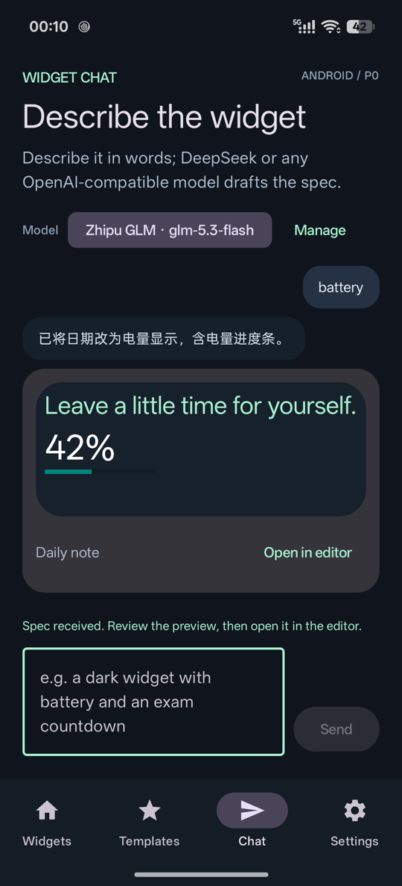
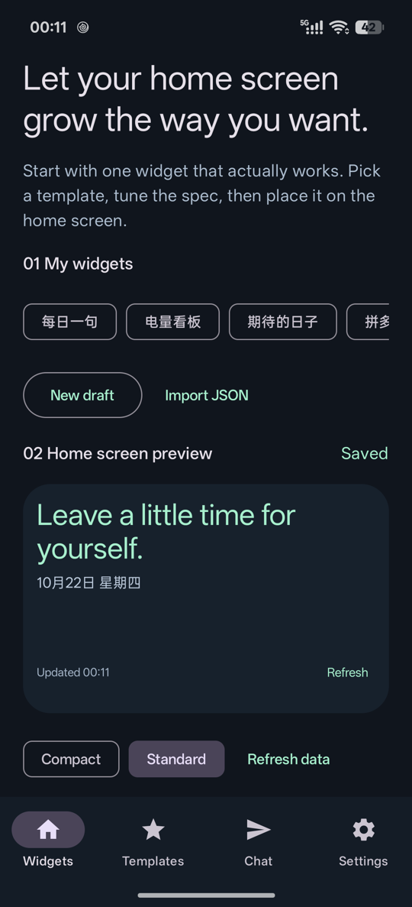
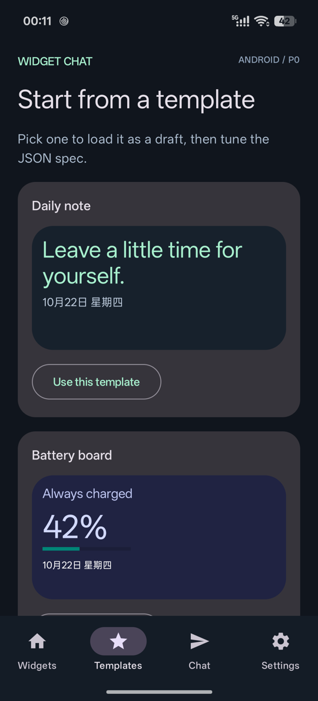
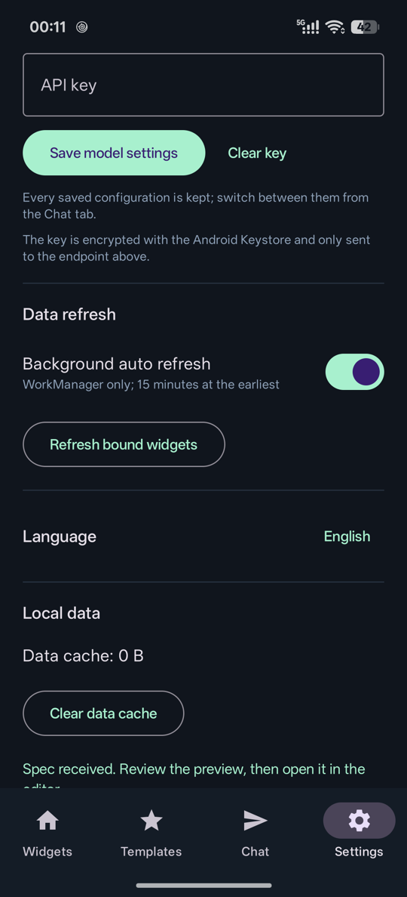

# Widget Chat Android

[English](README.md) | 简体中文

用自然语言定制 Android 桌面小组件。当前为 **P0 技术原型**：已实现配置驱动的预览与桌面组件，并接入 OpenAI 兼容模型（DeepSeek 等）通过对话生成配置。

## 界面截图

| 对话生成 | 组件库与预览 | 模板 | 设置 |
| :---: | :---: | :---: | :---: |
|  |  |  |  |

> 截图为英文界面，跟随应用语言设置。

## 当前能力

- 组件 / 模板 / 对话 / 设置四个 Tab：组件库与预览、模板画廊、对话生成、模型/刷新/缓存管理。
- 对话生成：设置中可配置 DeepSeek、OpenAI 或任意 OpenAI 兼容接口（模型名、Base URL、API Key）；模型返回的 WidgetSpec 会先校验并预览，再应用到编辑器保存。API Key 用 Android Keystore 加密保存。
- 每日一句、电量、倒计时三个模板。
- WidgetSpec JSON 校验与编辑；横纵布局、文字、间距、进度条。
- 使用真正的 RemoteViews 在应用中预览，支持小卡片、标准高度，并可跟随已绑定桌面的真实尺寸。
- 组件库、本地原子存储、另存副本、最近十个版本和回滚。
- JSON 导入导出；系统添加桌面、配置页面、手动刷新和多实例绑定。
- 点击桌面组件返回对应记录；系统刷新与 WorkManager 周期刷新并用，后台最短 15 分钟，执行时间由 Android 决定。
- 节点级 `click`：任意节点可设置 `scheme://…`，点击直接打开对应应用或页面；未设置时点击整卡返回编辑器。
- WidgetSpec v2 数据源：`STATIC`、`HTTP`（仅 https）、`SCRIPT`（QuickJS）和 `SYSTEM`（免权限设备信息）；按 `dependsOn` 顺序执行，支持 TTL、`fallback` 和预览用 `sample`。

暂不支持日历、任意图片、精确分钟级刷新和运行时下发脚本。脚本引擎为 16 KB 页对齐的 QuickJS 预编译库（Apache-2.0），加载失败时数据源会降级到缓存或 `fallback`。

## 构建与运行

需要 JDK 17、Android SDK 35、Android 12+ 设备。依赖版本固定为兼容组合；首次构建需要下载依赖。

```sh
./gradlew :app:assembleDebug :app:testDebugUnitTest :app:lintDebug
adb -s <设备序列号> install -r app/build/outputs/apk/debug/app-debug.apk
adb -s <设备序列号> shell am start -n app.widgetchat/.ui.MainActivity
```

Android Studio 可直接打开项目根目录。SDK 路径通过 ANDROID_HOME 或未入库的 local.properties 设置。

## 使用

1. 选择模板，在预览中查看真实日期和电量。
2. 展开 JSON 编辑器，修改 name、background、text、textSize、targetDate、click，或在 `data.sources` 中配置数据源。
3. 点击“校验并预览”，确认后保存；“另存副本”创建独立组件。
4. 点击“添加到桌面”，完成系统确认；也可从桌面组件列表选择 Widget Chat。
5. 多个桌面实例可以选择不同记录；同一记录的修改会更新所有绑定它的实例。需要独立修改时先另存副本。
6. 长按桌面组件重新配置，或点击组件内容返回编辑；点“刷新”更新本地数据。
7. “设置”页可关闭后台自动刷新、立即刷新已绑定组件、清除数据缓存并查看存储占用。

新添加默认 4×3；已有小卡片会自动缩小文字并优先显示主要内容。空间不足时可在桌面长按组件增高。预览能读取启动器分配的尺寸；复杂布局仍需实际测试。

## 数据源与刷新

同一记录的多个桌面实例共享缓存；渲染只读缓存，取数只由 WorkManager 周期任务、手动刷新或系统 `onUpdate` 触发。

```json
{
  "schemaVersion": 2,
  "name": "天气",
  "root": {
    "type": "COLUMN",
    "children": [
      { "type": "TEXT", "textSize": 28, "binding": "DATA", "source": "shaped", "field": "temp", "fallback": "--" }
    ]
  },
  "data": {
    "sources": {
      "weather": {
        "type": "HTTP",
        "url": "https://api.example.com/weather",
        "pick": "data.now",
        "ttlSeconds": 900,
        "fallback": { "temp": "--" }
      },
      "shaped": {
        "type": "SCRIPT",
        "dependsOn": ["weather"],
        "timeoutMs": 2000,
        "script": "function refresh(ctx) { return { temp: ctx.sources.weather.temp + '°' }; }",
        "sample": { "temp": "23°" }
      }
    }
  }
}
```

文字或进度条使用 `"binding": "DATA"`，并给出 `source`、`field`；可选的 `fallback` 在该字段缺失时显示。`sample` 只用于编辑器预览。

`SYSTEM` 数据源由 Kotlin 侧采集免权限设备信息，结果与其它来源一样写入缓存，脚本只能通过 `ctx.sources` 读取：

```json
{
  "clock": { "type": "SYSTEM", "system": "CLOCK", "ttlSeconds": 60 },
  "net": { "type": "SYSTEM", "system": "NETWORK" }
}
```

| `system` | 字段 |
| --- | --- |
| `BATTERY` | `percent`（未知时缺失）、`charging`、`status`（`charging`/`full`/`discharging`/`not_charging`/`unknown`） |
| `CLOCK` | `now`、`date`、`time`、`weekday`（跟随系统语言）、`timezone`、`epochSeconds` |
| `NETWORK` | `connected`、`type`（`wifi`/`cellular`/`ethernet`/`vpn`/`other`/`none`）、`metered` |
| `LOCALE` | `language`、`region`、`timezone`、`hour24` |
| `STORAGE` | `freeGb`、`totalGb`、`usedPercent` |

`SYSTEM` 源不支持 `value`/`url`/`pick`/`script`/`dependsOn`；`system` 名不在上表内会校验失败。所有采集都是同步、免运行时权限的（仅声明 `ACCESS_NETWORK_STATE`），不做定位、传感器、剪贴板等需要授权或后台受限的能力。由于渲染只读缓存，`CLOCK`/`BATTERY` 的值停留在最近一次刷新时刻，需要跟随时钟或电量的实时显示仍应使用节点的 `DATE`/`BATTERY` 绑定。

## 点击跳转（click）

任意节点都可以加 `"click": "scheme://…"`，渲染时挂到该节点的 RemoteViews 上；点击时由最具体的节点响应，容器与子节点同时设置时子节点优先。根节点也设置 `click` 后，整卡不再默认返回编辑器。

```json
{
  "type": "COLUMN",
  "click": "widgetchat://edit",
  "children": [
    { "type": "TEXT", "text": "天气", "click": "https://weather.example.com" },
    { "type": "TEXT", "text": "限时活动", "click": "exampleapp://promo/detail?id=123" }
  ]
}
```

- `widgetchat://` 由本应用处理，当前支持 `widgetchat://edit/<recordId>` 直接定位到记录；其它路径打开编辑器。
- 其它 scheme 以 `ACTION_VIEW` 启动系统或第三方应用；未安装对应应用时点击无反应。
- 校验只放行 `scheme:` 形式且长度 ≤ 2048 的 URI，`file`、`content`、`javascript`、`data`、`intent` 等 scheme 会被拒绝。
- 国内 ROM 对桌面组件拉起后台应用有额外限制，部分机型可能静默失败，需要真机验证；预览中的组件不响应 click，避免编辑时跳出应用。

脚本在独立线程的 QuickJS 中执行，必须同步返回 JSON 对象（字符串、数字或布尔值，最多 32 个字段），入参为 `ctx.now`、`ctx.battery`、`ctx.sources`、`ctx.cache`。`ttlSeconds` 决定后台任务是否真正取数；WorkManager 最短周期 15 分钟且不保证准时，Doze 下可能更晚。

## 目录

- app/src/main/java/app/widgetchat/model：配置协议、校验、数据绑定与模板。
- data：本地存储与版本、实例映射、数据缓存、HTTP/QuickJS/SYSTEM 取数与 WorkManager 调度。
- render：共享 RemoteViews 渲染器。
- widget：桌面生命周期、添加回调。
- ui：组件库、配置编辑与系统配置界面。
- app/src/test：协议和绑定测试。
- app/src/androidTest：Android 渲染、存储、数据刷新与脚本执行测试。

此仓库尚未选择对外发布许可证。没有直接复制竞品实现。
